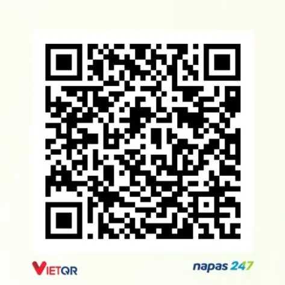

# Ext VBook W

Kho extension cho VBook và VBook Beta.

## Cách cài nguồn

1. Mở app VBook hoặc VBook Beta.
2. Vào **Quản lý nguồn** hoặc **Kho lưu trữ**.
3. Chọn thêm nguồn mới.
4. Dán link này:

```text
https://raw.githubusercontent.com/BaoBao666888/ext-vbook-w/main/plugin.json
```

5. Lưu lại, sau đó tải/cập nhật extension trong app.

## Lưu ý

- Các extension đọc truyện dùng được trên bản VBook thường, trừ 1 số ext đặc biệt.
- Các extension video chỉ xem được trên VBook Beta.
- Muốn dùng extension Khởi điểm, QQ Book, Fanqie, Faloo thì liên hệ Discord để lấy riêng.

## Liên hệ

Discord: `quocbao7276`
Email: `quocbao120621@gmail.com`

## Donate

Cảm ơn nếu bạn ủng hộ nhoa :>.



## Bản quyền và điều kiện sử dụng

Copyright (c) 2026 BaoBao666888. All rights reserved.

Người dùng được phép tải xuống, nghiên cứu, giải mã và chỉnh sửa các extension do tác giả sở hữu để sử dụng cá nhân.

Mọi hình thức tái phân phối, công bố mã nguồn gốc hoặc đã giải mã, phát hành phiên bản chỉnh sửa đều cần có sự đồng ý trước của tác giả.

Không được xóa, giả mạo hoặc thay đổi thông tin tác giả gốc nhằm nhận quyền tác giả đối với mã nguồn.

Tác giả chỉ hỗ trợ các phiên bản được phân phối chính thức. Các thành phần bên thứ ba tiếp tục tuân theo giấy phép riêng của chúng.

Các điều khoản trên chỉ áp dụng cho phần mã nguồn thuộc quyền sở hữu của BaoBao666888. Những extension được kế thừa hoặc chỉnh sửa từ tác giả khác vẫn giữ nguyên quyền tác giả và tuân theo giấy phép của tác giả gốc.